**Fatemeh Mohammadi
SID: 810199489
HW1**

---

NOTE: Suggest use RL_HW1_810199489.md instead of RL_HW1_810199489.pdf, due to the better formatting.

---

# Q1. Food Recommendation System

## **Introduction**

This project aims to design and evaluate a **food recommendation system** using **reinforcement learning algorithms**. Each "arm" represents a type of food, and the reward probability reflects a user's satisfaction with that food. The system's goal is to maximize user satisfaction by dynamically recommending the best foods based on learned preferences.

The **multi-armed bandit problem** framework was chosen to model this system, where algorithms like **Thompson Sampling**, **Upper Confidence Bound (UCB)**, and **Epsilon-Greedy** were implemented to optimize recommendations over time.

---

## **Problem Formulation**

1. **Number of Arms**:

   - The number of arms (food types) is determined by the remainder of the last three digits of the student ID divided by 5, plus 2.
   - My Side: 810199489: The remainder of `489 ÷ 5 = 4`, so the number of arms becomes 4 + 2 = 6.
2. **Reward Probabilities**:

   - The reward probabilities are derived from the last N digits of the student ID, normalized by dividing each digit by 10, where N is the number of arms.
   - My Side: For the student ID `810199489`, the reward probabilities are `[0.1, 0.9, 0.9, 0.4, 0.8, 0.9]`.
3. **Algorithm Implementations**:

   - **Thompson Sampling**: Uses a **Beta distribution** for each arm to model uncertainty and make decisions.
   - **Upper Confidence Bound (UCB)**: Implements the exploration-exploitation trade-off with the parameter \( c = 1 \).
   - **Epsilon-Greedy**: Dynamically adjusts the epsilon parameter to balance exploration and exploitation.

---

## **Algorithm Explanation and Pseudocode**

NOTE: All Python code is in notebooks, so please refer to the corresponding notebooks for more details.

### **1. Thompson Sampling**

- **Explanation**: Thompson Sampling selects an arm by sampling from the Beta distribution of each arm's success probability. The arm with the highest sampled probability is selected.
- **Pseudocode**:
  ```
  Initialize: alpha, beta = initial_alpha, initial_beta for each arm
  For each round:
      For each arm:
          Draw a sample from Beta(alpha, beta)
      Select the arm with the highest sampled value
      Update alpha and beta based on the received reward
  ```

### **2. Upper Confidence Bound (UCB)**

- **Explanation**: UCB selects the arm with the highest upper bound of a confidence interval, ensuring that arms with less exploration are chosen to improve exploration-exploitation balance.
  For each arm, UCB calculates a score based on the formula:

$\text{UCB}(a) = \hat{\mu}_a + c \times \sqrt{\frac{\ln t}{N_a}}$

Where:

- $ \hat{\mu}_a $: The average reward obtained from arm $ a $ so far (this is the **exploitation** term).
- $ c $: A constant that controls the amount of exploration.
- $ t $: The current time step (or number of rounds played).
- $ N_a $: The number of times arm $ a $ has been played so far (this affects **exploration**).

The **confidence interval** $ \sqrt{\frac{\ln t}{N_a}} $ shrinks as we play an arm more frequently, meaning the algorithm becomes more confident about its average reward. Arms that have been tried less often will have larger confidence intervals, giving them a chance to be explored.

- **Pseudocode**:
  ```
  Initialize: counts = 0, means = 0 for each arm
  For each round:
      Calculate UCB for each arm: UCB = mean + c * sqrt(log(total_selections) / count)
      Select the arm with the highest UCB value
      Update counts and means based on the reward
  ```

### **3. Epsilon-Greedy**

- **Explanation**: Epsilon-Greedy selects a random arm with probability epsilon (exploration) and exploits the best-known arm otherwise. Epsilon decreases over time to favor exploitation.
- **Pseudocode**:
  ```
  Initialize: epsilon = initial_value, counts = 0, q_values = 0 for each arm
  For each round:
      If random < epsilon:
          Select a random arm (exploration)
      Else:
          Select the arm with the highest q_value (exploitation)
      Update q_value for the selected arm based on the reward
      Decrease epsilon over time
  ```

---

### Simulation

NOTE: Code is in notebooks, so please refer to the corresponding notebooks for more details.

---

### **Analysis and Comparison**

#### Cumulative Reward Comparison

- **Observation**:

  - With multiple optimal arms (three arms having a probability of 0.9), the algorithms likely found it easier to achieve high cumulative rewards, as there were more chances to exploit high-reward arms.
  - **Thompson Sampling**, **UCB**, and **Epsilon-Greedy** all showed similar cumulative reward performances, as seen in the plot. This is because all algorithms had multiple high-reward arms to choose from, reducing the complexity of the exploration phase.
- **Analysis**:

  - **Thompson Sampling**: Even though it balances exploration and exploitation based on the success-failure distribution, having three best arms reduces the need for extensive exploration. Thompson Sampling can quickly focus on the high-reward arms, as reflected in the cumulative reward plot.
  - **UCB**: Given multiple optimal arms, UCB's exploration is rewarded sooner than it might be in cases where only one arm is optimal. This explains why UCB’s cumulative reward performance was similar to Thompson Sampling’s.
  - **Epsilon-Greedy**: With multiple high-reward arms, even with higher initial exploration, Epsilon-Greedy was able to eventually exploit the best arms and accumulate rewards comparable to the other algorithms.

The presence of multiple optimal arms made the cumulative reward comparison more balanced, and the differences between the algorithms were less pronounced because each algorithm had more opportunities to exploit optimal arms earlier in the process.

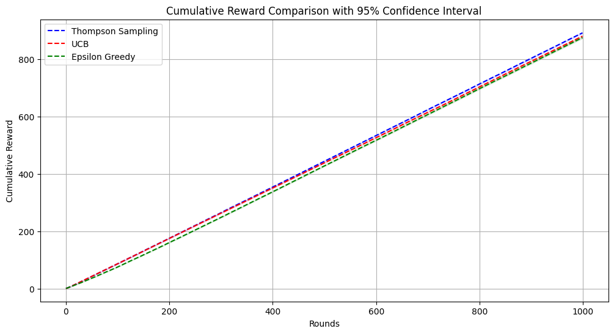

#### Cumulative Regret Comparison

- **Observation**:

  - In a scenario with three optimal arms, regret becomes more critical in terms of how much time an algorithm spends exploring suboptimal arms, especially the one with a probability of 0.1 and the one with 0.4.
  - **Epsilon-Greedy** showed the highest cumulative regret, as it likely spent more time exploring suboptimal arms before converging to the optimal ones.
  - **UCB** also experienced noticeable regret, likely due to continued exploration even after identifying the optimal arms.
  - **Thompson Sampling** again minimized regret, suggesting that its probabilistic exploration mechanism allowed it to focus on the optimal arms more quickly than the others.
- **Analysis**:

  - **Thompson Sampling**: With multiple best arms, Thompson Sampling’s exploration-exploitation balance allowed it to identify and stick to the high-reward arms sooner, minimizing regret.
  - **UCB**: Despite performing well in terms of cumulative reward, UCB experienced higher regret due to its more exploratory nature.
  - **Epsilon-Greedy**: The higher exploration rate early on meant that Epsilon-Greedy accumulated more regret before settling on the optimal arms.

So while having multiple optimal arms made reward accumulation easier, the algorithms still experienced varying levels of regret based on their exploration strategies. **Thompson Sampling** minimized regret the most effectively, followed by **UCB**, and **Epsilon-Greedy** had the highest regret due to its initial exploration phase.
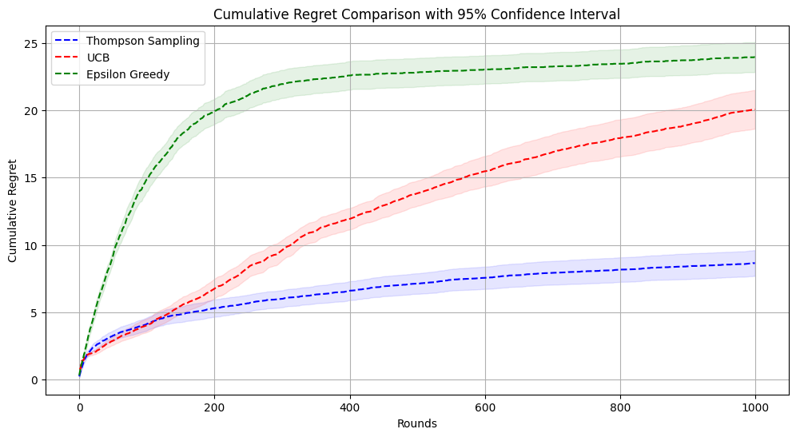

---

### **Parameter analysis**

#### 1. Thompson Sampling:

###### 1.1. **Impact of `initial_alpha > beta` (Exploration biased towards success)**

- When **`alpha` is larger than `beta`**, the algorithm starts with a stronger prior belief in the **success** of an arm, meaning it expects positive rewards more often than failures.
- **Cumulative Reward**:

  - The cumulative reward remains stable regardless of the difference between `alpha` and `beta`. However, early rounds may show quicker exploitation of arms, leading to slightly faster reward accumulation initially.
    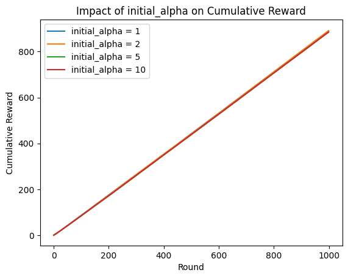
- **Cumulative Regret**:

  - **Higher `alpha` than `beta`** (`alpha = 10`, `beta = 1`) leads to **higher cumulative regret**. This happens because the algorithm tends to **exploit too early**—believing in success too soon—without sufficient exploration of the available arms, especially in a scenario where multiple arms have high probabilities.
  - As a result, the algorithm may prematurely lock into suboptimal arms before adequately exploring others, which leads to regret when better arms are missed.
    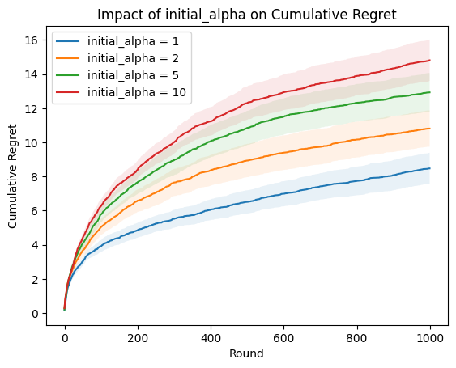

###### 1.2. **Impact of `initial_beta > alpha` (Exploration biased towards failure)**

- When **`beta` is larger than `alpha`**, the algorithm starts with a stronger prior belief in the **failure** of an arm, meaning it expects more negative outcomes initially.
- **Cumulative Reward**:

  - The cumulative reward remains similar across all settings, but the algorithm may take longer to exploit the best arms, leading to delayed reward accumulation.
    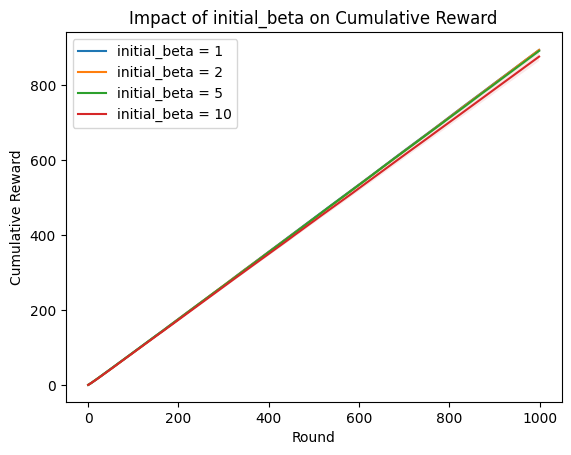
- **Cumulative Regret**:

  - **Higher `beta` than `alpha`** (`beta = 10`, `alpha = 1`) results in **higher initial exploration**. This is because the algorithm is cautious, assuming failure is more likely, and therefore spends more time trying different arms before committing to exploitation.
  - The additional exploration reduces cumulative regret over time as the algorithm takes longer to identify and exploit the best arms, but it avoids premature exploitation.
    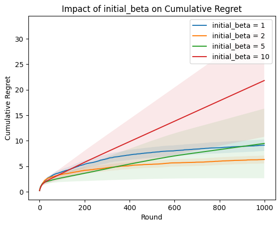

###### Comparative Summary:

- **When `alpha > beta`**:

  - The algorithm **exploits too early**, leading to higher regret. It is confident in the success of arms early on, which can cause it to miss the optimal arms if it commits prematurely.
  - This is a **riskier strategy** in scenarios where multiple arms are strong, as the algorithm may fail to explore fully.
- **When `beta > alpha`**:

  - The algorithm **explores more cautiously**, reducing cumulative regret by not rushing into exploitation. This strategy ensures that all arms are explored adequately, making it **safer** in environments where there are multiple high-probability arms.
  - However, it may take longer to accumulate rewards, especially in the early rounds, as the algorithm is initially more hesitant to exploit.

#### 2. UCB:

###### **2.1. Impact of `c` on Cumulative Reward**

- **Cumulative Reward**:
  - When **`c = 0.1`**, cumulative rewards are slightly higher compared to larger values of `c`. This indicates that **low exploration** (i.e., when the algorithm is more inclined to exploit known information) leads to faster reward accumulation.
  - As **`c` increases** (i.e., `c = 1, 2, 5`), cumulative rewards gradually decrease. Higher `c` values result in more exploration, causing slower reward accumulation in the early rounds, as the algorithm spends more time testing different arms before exploiting the best ones.
    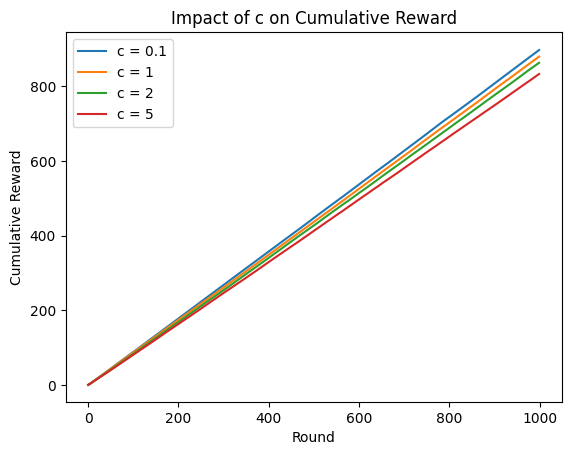

###### **2.2. Impact of `c` on Cumulative Regret**

- **Cumulative Regret**:
  - **Lower `c` (0.1)** results in **minimal regret**. This is because the algorithm favors exploitation from the beginning, reducing the number of times it chooses suboptimal arms.
  - As **`c` increases**, cumulative regret grows significantly. For instance, with **`c = 5`**, the algorithm experiences high regret because it explores extensively, spending a lot of time on arms that may not be optimal, before converging to the best arm.
  - The relationship between `c` and regret is clear: higher values of `c` increase regret as the algorithm balances exploration and exploitation over more rounds.
    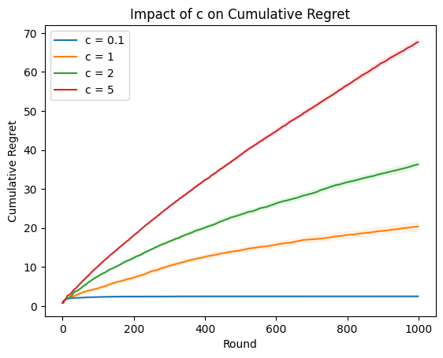

###### Overall Insights:

- **Cumulative Rewards**: Lower `c` values lead to quicker reward accumulation due to more focused exploitation. However, too little exploration might result in missing the optimal arm in scenarios with multiple strong arms.
- **Cumulative Regret**: Higher `c` values result in much higher cumulative regret because they force the algorithm to explore for longer, delaying convergence to the optimal arm.
- **Higher `c`** values promote more exploration, leading to higher regret. This is especially evident in environments where multiple arms have high probabilities, and the algorithm spends too much time exploring when it could have exploited known good arms.
- **Lower `c`** (closer to 0.1) lead to quicker reward accumulation because the algorithm focuses more on exploitation. However, the algorithm may miss out on finding the best arm if it explores too little.

#### 3. Epsilon-Greedy:

##### 3.1. **Impact of `initial_epsilon` on Cumulative Reward and Cumulative Regret**

- **Cumulative Reward**:
  - Across different `initial_epsilon` values (0.1, 0.3, 0.5, 0.9), cumulative rewards are very similar over time. This suggests that while exploration is influenced by the initial epsilon, the algorithm converges towards exploiting the optimal arms, resulting in similar long-term rewards.
    So We can say choice of `initial_epsilon` has a limited effect on long-term cumulative rewards.
    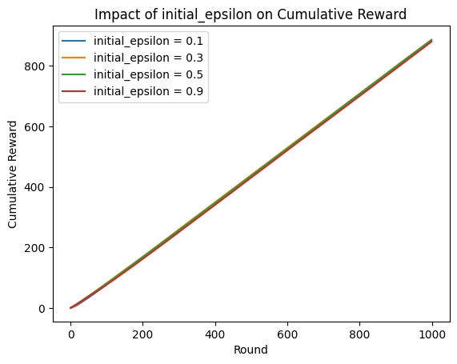
- **Cumulative Regret**:
  - Higher initial values of `epsilon` lead to significantly **higher cumulative regret**. This is because the algorithm spends more time exploring, which delays exploitation of the optimal arms.
  - As `epsilon` decreases, the algorithm explores less and exploits more, leading to **lower cumulative regret**.
    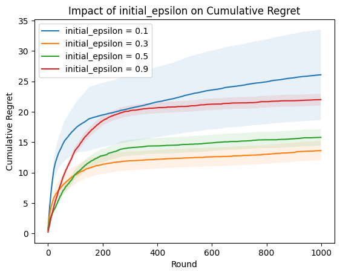

###### 3.2. **Impact of `decay_rate` on Cumulative Reward and Cumulative Regret**

- **Cumulative Reward**:

  - A **faster decay rate** leads to quicker exploitation and, therefore, **higher cumulative rewards** in the early and mid rounds.
  - Slower decay rates cause the algorithm to spend more time exploring, resulting in delayed exploitation, which **lowers cumulative rewards** early on.
  - **Conclusion**: Faster decay rates (around 0.9) are preferable for maximizing cumulative rewards in this scenario, as they allow the algorithm to switch to exploitation sooner.
    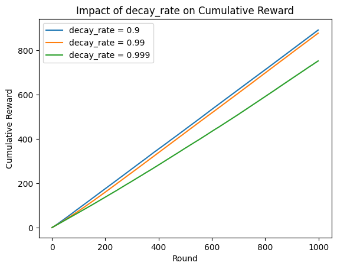
- **Cumulative Regret**:

  - **Faster decay rates** result in significantly **lower cumulative regret**, as the algorithm quickly transitions to exploiting high-probability arms.
  - **Slower decay rates** cause the algorithm to continue exploring for longer, which leads to **much higher cumulative regret** as it takes longer to converge on the optimal arms.
    So we can say faster decay rates minimize regret by allowing the algorithm to balance exploration and exploitation more effectively.
    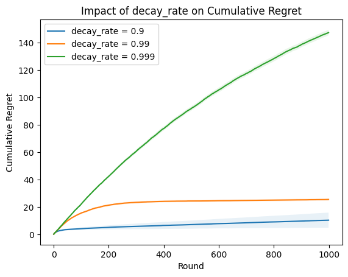

###### Overall Insights:

- **Initial Epsilon**: Higher initial epsilon values lead to higher regret due to excessive exploration. Setting `initial_epsilon` between **0.1 and 0.3** strikes a good balance, ensuring enough exploration without incurring too much regret.
- **Decay Rate**: A **faster decay rate** is better for both maximizing cumulative rewards and minimizing regret, as it allows for early exploitation of the best arms without unnecessary exploration.

---

# Q2. Advertising in an Online Store

## Introduction

In an online store, advertisements play a crucial role in driving user engagement and ultimately increasing conversions. The store offers two different types of advertisements for its products: Ad 1 and Ad 2. The challenge is to optimize the sequence in which these ads are shown to users to maximize their engagement, such as clicks or purchases. The goal is to determine the best strategy for selecting the **sequence** of advertisements to ensure the highest level of user interaction.

## Problem Statement

We are developing a recommendation system for an online store that shows one of two ads (Ad 1 or Ad 2) per product. The system only receives success information (e.g., clicks or purchases) after two ads are shown consecutively. The main goal is to learn the optimal sequence of ads to maximize user interaction by selecting the best combination of ads, resulting in the highest engagement.

### Problem Details

- **Actions:** Show Ad 1 or Ad 2.
- **Reward:** A reward is received after two consecutive ads are shown, indicating a successful interaction.
- **Goal:** Learn the optimal sequence of ads to maximize user engagement using a bandit algorithm.

## Solution Approaches

To solve this problem, we consider using a multi-armed bandit framework, with two possible formulations: a two-armed bandit (using MDP) and a four-armed bandit.

### Approach 1: 2-Arms Bandit (Using MDP)

#### 1. Formulating the Problem as an N-Armed Bandit Problem

##### Problem Formulation

- **Formulation:** In this approach, each advertisement is treated as an arm in a 2-armed bandit problem, with states representing the current advertisement shown.
- **Arm Definition:** Each arm represents an advertisement, either Ad 1 or Ad 2.
- **State Definition:** The states represent whether Ad 1 or Ad 2 was shown previously, impacting the selection of the next ad.
- **Reward Collection:** Rewards are collected after a sequence of two ads is shown to the user, allowing for learning about the effectiveness of different ad combinations.

Here is a basic scheme of this approach:
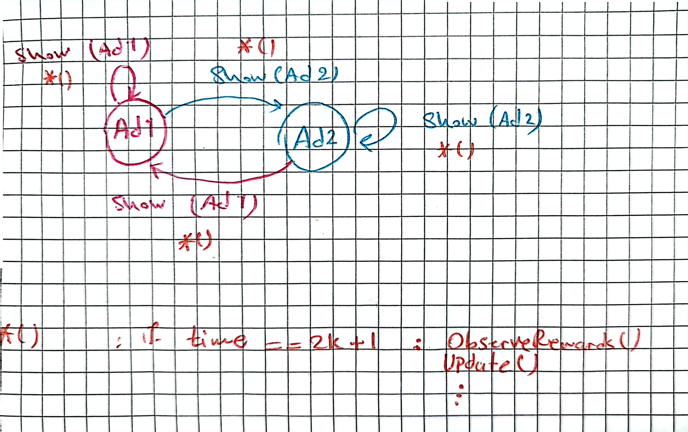

#### 2. Exploration-Exploitation Strategy

##### Epsilon-Greedy Strategy

- **Exploration:** Exploration is necessary to discover new strategies and learn the effectiveness of different ad combinations. The epsilon parameter determines the probability of selecting a random ad for exploration.
- **Exploitation:** Exploitation involves selecting the ad that has provided the highest reward so far, ensuring that the system focuses on the most effective strategies.
- **Balancing Strategy:** The epsilon-greedy strategy balances exploration and exploitation by adjusting the value of epsilon, allowing the system to adapt as it learns.

NOTE: Techniques like Upper Confidence Bound (UCB) or Thompson Sampling can also be employed.

#### Comparison with A/B Testing

- **Bandit vs. A/B Testing:** The bandit approach dynamically adjusts the ad selection based on ongoing results, while A/B testing divides traffic statically to compare performance. The bandit approach reduces the opportunity cost of showing less effective ads.
- **Benefits and Drawbacks:** A/B testing is simpler and provides clear statistical comparisons, but it lacks the adaptability of the bandit method. The bandit approach is more efficient in dynamic environments where user behavior may change over time.

#### Implementation Details

##### Algorithm Explanation

- **Q-Values:** The Q-values represent the expected reward for each action in each state. They are updated based on the observed reward after each pair of ads is shown.
- **Learning Rate (Alpha):** The learning rate controls how quickly the system updates its Q-values. A lower alpha results in slower learning but greater stability.

##### Pseudocode

```
Initialize q_value[state][action] = 0 for all states and actions
Initialize counts[state][action] = 0 for all states and actions
Set initial_epsilon to an exploration rate (e.g., 1.0)
Set min_epsilon to the minimum exploration rate (e.g., 0.01)
Set decay_rate to control how quickly epsilon decays (e.g., 0.99)
Initialize state randomly (either Ad 1 or Ad 2)
Initialize epsilon = initial_epsilon

While user is active:
    If t is even:
        Choose an action using the epsilon-greedy strategy
        Show the first ad based on the chosen action
        Update state to reflect the first ad (no reward to update yet)
    Else:
        Choose an action using the epsilon-greedy strategy
        Show the second ad based on the chosen action
        Observe the reward
        Update counts and Q-value:
            counts[state][action] += 1
            alpha = 1 / counts[state][action]
            q_value[state][action] += alpha * (reward - q_value[state][action])
        Update state to reflect the second ad
    Increment t
    Update epsilon: epsilon = max(min_epsilon, epsilon * decay_rate)
```

NOTE: We have implemented a Python function for this approach, available in the notebook.

##### Parameter Tuning

- **Epsilon (Exploration Rate):** Start with an initial epsilon value (e.g., 1.0) and gradually decrease it to shift from exploration to exploitation.
- **Learning Rate (Alpha):** The learning rate is calculated as `1 / counts[state][action]` to ensure stable convergence as more data is collected.

The 2-arms bandit approach treats each advertisement as an independent arm and uses an epsilon-greedy strategy to balance exploration and exploitation. This method allows the system to dynamically adapt and learn the best sequence of ads to maximize user engagement.

---

### Approach 2: 4-Arms Bandit

#### 1. Formulating the Problem as an N-Armed Bandit Problem

##### Problem Formulation

- **Formulation:** In this approach, each sequence of two ads is treated as a unique arm in a 4-armed bandit problem.
- **Arm Definition:** The arms represent specific sequences: Ad 1 followed by Ad 1, Ad 1 followed by Ad 2, Ad 2 followed by Ad 1, and Ad 2 followed by Ad 2.
- **Reward Collection:** Rewards are collected after a full sequence of two ads is shown, allowing direct attribution to specific ad combinations.

#### 2. Exploration-Exploitation Strategy

##### Epsilon-Greedy Strategy

- **Exploration:** Exploration ensures that the system tries all possible ad sequences to gather enough information about their effectiveness.
- **Exploitation:** Exploitation uses the ad sequence with the highest estimated reward to maximize user interaction.
- **Balancing Strategy:** The epsilon-greedy strategy provides a balance between exploring new sequences and exploiting known successful ones.

##### Comparison with A/B Testing

- **Bandit vs. A/B Testing:** Unlike A/B testing, the bandit approach continuously learns and adapts, making it more efficient for optimizing ad sequences in real-time.
- **Benefits and Drawbacks:** While A/B testing is useful for controlled experiments, the bandit approach is better suited for environments where rapid adaptation is needed.

#### Implementation Details

##### Algorithm Explanation

- **Q-Values:** The Q-values represent the expected reward for each ad sequence and are updated based on observed performance.
- **Learning Rate (Alpha):** The learning rate affects how quickly the Q-values are updated, ensuring that recent rewards have an appropriate impact on future decisions.

##### Pseudocode

```
Initialize q_values[action] = 0 for all actions (4 sequences)
Initialize counts[action] = 0 for all actions
Set initial_epsilon to an exploration rate (e.g., 1.0)
Set min_epsilon to the minimum exploration rate (e.g., 0.01)
Set decay_rate to control how quickly epsilon decays (e.g., 0.99)
Initialize epsilon = initial_epsilon

While user is active:
    If t is even:
        Choose action using epsilon-greedy strategy
        Set current_sequence to the chosen sequence
        Show the first ad in current_sequence
    Else:
        Show the second ad in current_sequence
        Observe reward
        Update counts and Q-value:
            counts[action] += 1
            alpha = 1 / counts[action]
            q_values[action] += alpha * (reward - q_values[action])
    Increment t
    Update epsilon: epsilon = max(min_epsilon, epsilon * decay_rate)
```

NOTE: We have implemented a Python function for this approach, available in the  notebook.

##### Parameter Tuning

- **Epsilon (Exploration Rate):** Start with a relatively high epsilon value for more exploration, then reduce it to focus on the best-performing sequences.
- **Learning Rate (Alpha):** The learning rate is adjusted based on the number of times each sequence has been selected, ensuring stable convergence.

The 4-arms bandit approach treats each unique sequence of two ads as an independent arm, allowing for a more granular understanding of the effectiveness of different ad combinations. This approach can help optimize user engagement by selecting the best sequences based on observed rewards.

---

# Q3. Social Mobile  with Sparse Rewards

## Introduction

In a world where our devices learn from interactions, one critical challenge is to provide an effective personalized service despite sparse rewards from users. This report addresses the problem of how a mobile phone, acting as an agent, can learn the best service for its user through social reinforcement learning. Here, the agent can also observe other mobile agents interacting with their users, but it does not have access to their rewards. The goal is to find strategies to improve learning efficiency, given that direct rewards are sparse and observational information is limited.

## 1. Problem Formulation:

This problem can be formulated as a social reinforcement learning problem where an agent (the mobile phone) learns a policy to provide appropriate service to its **user**. The elements of the problem are:

-**Agents**: Several mobiles act independently, each trying to learn the best possible policy for its user.

-**Actions**: Each mobile phone has `n` possible actions.

-**Rewards**: Each agent receives sparse rewards from its user, which are random and vary over time.

-**Observational Information**: Agents can observe the actions taken by other agents but cannot directly observe their rewards.

The challenge here is to leverage these sparse rewards and observational information from other agents to develop a policy that maximizes the user's satisfaction.

This setting can be seen as **a multi-agent reinforcement learning problem** where agents interact by observing each other's behavior (actions) without explicitly communicating rewards.

## Solution Approaches

### 1. General Approach to Solve the Problem

To solve and formulate this problem, we can use imitation learning techniques to enhance the agent's learning.

-**Social Imitation (Using Observational Information)**: Observational information is used to influence the agent's action selection, incorporating a component of imitation into the learning process.

-**Exploration-Exploitation Strategy**: To manage exploration and exploitation effectively given sparse rewards, we can use an ε-greedy strategy, which involves balancing exploration and exploitation by selecting random actions with probability ε and choosing the best-known action otherwise.

- NOTE: Techniques like Upper Confidence Bound (UCB) or Thompson Sampling can also be employed.

#### Proposed Algorithm: Social Q-Learning with Imitation

We propose a variant of the Q-learning algorithm that incorporates social imitation. The idea is to not only update the Q-values based on the agent's own rewards but also adjust them based on the observed actions of other agents.

**Pseudocode: Social Q-Learning with Imitation**

```python
def do_action(action):
    pass

def observe_reward():
    pass

def run_and_get_reward(action):
    do_action(action)
    return observe_reward()

def get_observed_actions(agents):
    for agent in agents:
        pass
    pass

def general_approach_social_mobile(user_is_active, agents, episodes, actions, imitation_weight_ = 0.5, initial_epsilon=1.0, min_epsilon=0.01, decay_rate=0.99):
    q_values = np.zeros(actions)
    counts = np.zeros(actions)
    imitation_weight = imitation_weight_
    t = 0
    epsilon = initial_epsilon

    for episode in episodes:
        while(user_is_active):
            if random() < ε: # Exploration
                action = np.random.choice(actions)
            else: # Exploitation
                action = np.argmax(q_values[action])

            do_action(action)
            reward = run_and_get_reward(action)
            alpha = 1 / counts[action]
            q_values[action] += alpha * (reward - q_values[action])

            # Observe actions of other agents
            observed_actions = get_observed_actions(agents)

            # Imitation: Update Q-values based on observed actions
            for observed_action in observed_actions:
                q_values[observed_action] += imitation_weight  * (1 - q_values[observed_action])

            t +=1
            epsilon = max(min_epsilon, epsilon * decay_rate)

    return q_values

```

**Explanation**:

-**Q-Value**: The Q-value for each action is updated based on BOTH the agent's own reward and the observed reward.

-**Imitation Weight (α)**: Controls how much weight the agent gives to actions of other agents.

-**Action Selection**: The agent follows an ε-greedy strategy, exploring with probability ε, and exploiting otherwise.

-**Q-Value Update**: Q-values are updated both based on the agent's own reward and the observed actions of other agents.

-**Epsilon-Decay**: The agent's exploration rate decays over time.

NOTE: This approach is the base approach for solving the problem and we will improve it in the next steps and consider the above explanation are true for other approaches as well, so we won't repeat this explanation for other approaches.

### 2. Selective Observation and Learning (Alternative Approach) (Reduce computation time, memory usage)

- Observing all other agents may be computationally expensive and slow.Also it may cause agent to be unable to learn the optimal policy beacause of the large number of agents with diversity in their policies.An alternative approach is to select a subset of agents that are likely to provide the most valuable information for learning.
- Also observing other agents at every step may be too expensive. We can do it repeatedly at some interval.

-**Selecting High-Performing Agents**: The agent selects the most promising agents for observation based on their consistency and estimated success. Metrics such as the frequency of successful actions and consistency over time can be used to identify high-performing agents.

-**Adaptive Agent Selection**: The set of observed agents is updated periodically based on recent performance to ensure that only the most reliable agents are observed.

**Pseudocode: Selective Observation Strategy**

```python
def select_top_agents(score_dict, k):
    return sorted(score_dict, key=score_dict.get, reverse=True)[:k]

def update_scores(score_dict, observed_agents, observed_actions, q_values):
    pass # We will implement this in the next step

def selective_observation_social_mobile(user_is_active, agents, episodes, actions, imitation_weight_ = 0.5, initial_epsilon=1.0, min_epsilon=0.01, decay_rate=0.99, evaluation_period_ = 2, k = 5):
    q_values = np.zeros(actions)
    counts = np.zeros(actions)
    imitation_weight = imitation_weight_
    t = 0
    epsilon = initial_epsilon
    observed_agents = set()

    evaluation_period = evaluation_period_
    score_dict = {}

    for episode in episodes:
        while(user_is_active):
            if random() < ε: # Exploration
                action = np.random.choice(actions)
            else: # Exploitation
                action = np.argmax(q_values[action])

            do_action(action)
            reward = run_and_get_reward(action)
            alpha = 1 / counts[action]
            q_values[action]+= alpha * (reward - q_values[action])

            if t % evaluation_period == 0:
                observed_agents = select_top_agents(score_dict, k)

                # Observe actions of selected agents
                observed_actions = get_observed_actions(observed_agents)
                for observed_action in observed_actions:
                    q_values[observed_action] += imitation_weight  * (1 - q_values[observed_action])
                    # Update scores for each agent based on their observed consistency

                update_scores(score_dict, observed_agents, observed_actions)

            t +=1
            epsilon = max(min_epsilon, epsilon * decay_rate)

    return q_values
```

**Explanation**:

-**Score Dictionary `score_dict`**: Keeps track of scores for agents based on their observed behavior, including factors like consistency, quality of actions, and diversity.

-**Dynamic Agent Set `observed_agents`**: Agents selected for observation change over time to reflect the most useful agents, with scores being updated periodically to determine which agents remain in the observed set.

-**Balancing Exploration and Exploitation**: The exploration rate (ε) decays over time, gradually shifting the focus from exploration to exploitation. Observed actions from high-performing agents are integrated into the learning process to improve the agent's policy.

-**Evaluation Period `evaluation_period`**: The agent selects the top-performing agents for observation at every `evaluation_period` steps.

##### - **Scoring Agents: Key Considerations**

To update `score_dict`, the goal is to assign scores to each agent based on the usefulness of their actions. This usefulness can be defined by factors like consistency, inferred success, or action patterns that align with good results. Here are some scoring strategies:

    -**Consistency of Actions**: If an agent frequently selects a particular action in a similar context, it may indicate that the agent has identified an effective policy. An agent can be assigned a higher score when it repeats a successful action multiple times.

    -**Observed Action Quality**: Since we cannot directly see the rewards of other agents, we need to estimate the quality of their actions indirectly. One approach is to compare their actions with our own learned policy. If an agent consistently chooses actions that have high Q-values in our own policy, it is more likely that this agent has a good policy and should be scored higher.

    -**Diversity**: Agents that show a diverse set of actions might also be valuable, especially in the initial stages of learning, to introduce variety into our policy. The score could be increased if the observed agent explores new actions that we haven’t considered or tested enough.

These are some basic considerations that can be used to update `score_dict`, but we will can add more strategies (But because of complexity we won't cover them).

**Pseudocode for Updating `score_dict`**

```python
def update_scores(score_dict, observed_agents, observed_actions, q_values):
    for agent, action in zip(observed_agents, observed_actions):
        # Consistency Update: Increase score if the agent repeats an action
        if score_dict[agent]["last_action"] == action:
            score_dict[agent]["score"] += 1  # Increment for consistency
        else:
            score_dict[agent]["last_action"] = action  # Update last action

        # Quality Update: Increase score if the action matches our high-Q action
        if q_values[action] > q_values.mean():  # Compare with an average or threshold Q-value
            score_dict[agent]["score"] += 2  # Increment more for good actions

        # Diversity Update: Increase score if the agent takes an action not frequently observed
        if action not in score_dict[agent]["observed_actions"]:
            score_dict[agent]["score"] += 1  # Increment for introducing diversity
            score_dict[agent]["observed_actions"].add(action)  # Track observed actions

        # Decay Score Over Time :Reduce scores gradually if the agent is no longer being useful
        score_dict[agent]["score"] *= 0.99  # Small decay factor to allow new agents a chance

# Initialization for score_dict
score_dict = {agent: {"score": 0, "last_action": None, "observed_actions": set()} for agent in agents}
```

**Explanation**

-**Consistency Update**: If an agent repeats the same action as the previous time step, it suggests that the agent is confident in its choice. The score is increased by 1 when an agent’s current action matches its previous action.

-**Quality Update**: Compare the observed action with our current Q-values. If the action has a high Q-value in our own table, it indicates that the observed agent is taking high-quality actions. The score is increased by 2 if the observed action has a Q-value greater than a predefined threshold (e.g., the mean of all Q-values).

-**Diversity Update**: If the observed action is new or not frequently observed, the agent’s score is increased. This helps capture diverse behaviors and ensures that we do not fall into local optima too early.

-**Decay Over Time**: To ensure that the agent set remains adaptive, we apply a small decay to the scores over time. This allows new agents to catch up and be selected for observation if they demonstrate good actions.

### 3. Adaptive Social Learning: Adaptive Learning from User Rewards (Focus on considering **Sparse** Rewards)

In scenarios with **sparse rewards**, the agent should prioritize learning from direct user rewards when they are available and use social observations only during the absence of rewards. This strategy offers two main benefits:

-**Prioritizing the Credible Source**: When a reward is directly received from the user, it is the most reliable feedback available. The agent should prioritize this information over any indirect data from observing other agents. This ensures the agent quickly aligns its actions with user preferences when rewards are present.

-**Reducing Noise During Reward Availability**: Relying solely on direct user feedback during reward availability prevents the agent from being influenced by potentially noisy information from other agents. By clearly distinguishing between phases with and without user rewards, the agent can maintain a more robust policy.

**Approach Overview: Adaptive Social Observation**

This approach defines two distinct phases:

-**Reward Phase**: When a reward is provided by the user, the agent focuses solely on updating its policy based on this reward, ignoring observational data.

-**Non-Reward Phase**: When no reward is available, the agent uses the observed actions of other agents to adapt and explore the action space.

**Benefits**:
-**Effective Exploitation of Rewards**: Rewards from the user are typically rare but provide highly credible information about the user's preferences. Focusing solely on this feedback allows for precise exploitation of positive actions.

-**Guided Exploration in Absence of Rewards**: During non-reward phases, the agent can benefit from observing other agents, using their actions as a guide to explore other parts of the action space more effectively. This ensures continuous learning, even when direct feedback is unavailable.

-**Noise Reduction**: By distinguishing between the reward and non-reward phases, this approach reduces the impact of potentially noisy or inconsistent actions of other agents on the agent's policy, making learning more robust.

**Modified Algorithm for Adaptive Social Observation**

Pseudocode for Adaptive Social Learning:

```python
def adaptive_social_mobile(user_is_active, agents, episodes, actions, imitation_weight_ = 0.5, initial_epsilon=1.0, min_epsilon=0.01, decay_rate=0.99, evaluation_period_ = 2, k = 5):
    q_values = np.zeros(actions)
    counts = np.zeros(actions)
    imitation_weight = imitation_weight
    t = 0

    evaluation_period = evaluation_period_
    epsilon = initial_epsilon
    observed_agents = set()
    score_dict = {}

    for episode in episodes:
        while(user_is_active):
            if random() < ε: # Exploration
                action = np.random.choice(actions)
            else: # Exploitation
                action = np.argmax(q_values[action])

        reward = run_and_get_reward(action)

        if reward is not None: # Reward Phase: Update Q-value based on direct user reward
            alpha = 1/counts[action]
            q_values[action] += alpha * (reward - q_values[action])

        else:# Non-Reward Phase: Select top-performing agents for observation
            # Adjust evaluation period based on risk preference
            # Longer evaluation period for risk-averse users after negative rewards
            if R > 0.5:
                evaluation_period = max(1, evaluation_period // 2)  # More frequent evaluation for risk-seeking users
            else:
                evaluation_period = evaluation_period * 2  # Less frequent evaluation for risk-averse users

            if t % evaluation_period == 0:
                observed_agents = select_top_agents(score_dict, k)

                # Observe actions of selected agents
                observed_actions = get_observed_actions(observed_agents)
                for observed_action in observed_actions:
                    q_values[observed_action] += imitation_weight  * (1 - q_values[observed_action])
                    # Update scores for each agent based on their observed consistency

                update_scores(score_dict, observed_agents, observed_actions)

        t +=1
        epsilon = max(min_epsilon, epsilon * decay_rate)

    return q_values

```

**Explanation of Key Changes**

-**Conditional Update Based on Reward**: After executing an action, the agent checks whether a reward is received (reward is not None). If a reward is received, the agent only updates the Q-value for the action based on that reward, ensuring the update is driven purely by reliable user feedback. If no reward is received, the agent enters the Non-Reward Phase, where it can observe and learn from other agents.

-**Selective Use of Observational Data**: In the Non-Reward Phase, the agent selects a subset of top-performing agents to observe, based on the updated scores. This ensures that social learning is used only when direct feedback is unavailable, helping compensate for the sparsity of rewards.

**Benefits of This Approach**

-**Better Exploitation of Sparse Rewards**: Since the reward is sparse but highly reliable, prioritizing it ensures that the agent maximizes learning from the most credible source of information. This reduces the chances of the agent being misled by observing other agents when its user provides feedback.

-**Enhanced Learning During Exploration**: During the absence of rewards, social observations become crucial for exploring new strategies or adapting to similar environments, ensuring that the agent doesn't stagnate in its learning process.

-**Noise Reduction**: By distinguishing between the reward and non-reward phases, this approach reduces the impact of potentially noisy or inconsistent actions of other agents on the agent's policy, making learning more robust.

### 4. Adaptive Exploration Based on User Risk Preferences (**Prospect Theory**)

Different users may have different tolerances for risk, and this affects the learning strategy of the agent. Users can be categorized as either risk-averse or risk-seeking.

- **Risk-Seeking Users:**
  For users with high risk tolerance (R > 0.5), the evaluation period is shorter, meaning that the agent observes other agents more frequently.
  This leads to more frequent social learning and faster adaptation to new strategies observed in other agents, which aligns with the user's risk-seeking nature.
- **Risk-Averse Users:**
  For users with low risk tolerance (R <= 0.5), the evaluation period is longer, meaning that the agent observes other agents less frequently.
  This ensures that the agent relies more on its own experience and provides consistent behavior, which matches the user's risk-averse nature.

**Pseudocode: Risk Preference-Based Exploration**

```python
def adaptive_social_mobile_prospectTheory(user_is_active, agents, episodes, actions, imitation_weight_ = 0.5, initial_epsilon=1.0, min_epsilon=0.01, decay_rate=0.99, evaluation_period_ = 2, k = 5, r = 0.5):
    q_values = np.zeros(actions)
    counts = np.zeros(actions)
    imitation_weight = imitation_weight
    R = r
    t = 0

    evaluation_period = evaluation_period_
    epsilon = initial_epsilon
    observed_agents = set()
    score_dict = {}

    for episode in episodes:
        while(user_is_active):
            if random() < epsilon: # Exploration
                action = np.random.choice(actions)
            else: # Exploitation
                action = np.argmax(q_values[action])

        reward = run_and_get_reward(action)

        if reward is not None: # Reward Phase: Update Q-value based on direct user reward
            alpha = 1/counts[action]
            q_values[action] += alpha * (reward - q_values[action])

            # if action is novel or less frequently chosen - Increase R if user rewards
            if counts[action] == min(counts):
                R = min(1, R + 0.05)
            else:
                R = max(0, R - 0.05)

            if R > 0.5:
                evaluation_period = max(1, base_evaluation_period // 2)  # More frequent evaluation for risk-seeking users
            else:
                evaluation_period = base_evaluation_period * 2  # Less frequent evaluation for risk-averse users

        else:# Non-Reward Phase: Select top-performing agents for observation
            # Adjust evaluation period based on risk preference
            # Longer evaluation period for risk-averse users after negative rewards
            if R > 0.5:
                evaluation_period = max(1, evaluation_period // 2)  # More frequent evaluation for risk-seeking users
            else:
                evaluation_period = evaluation_period * 2  # Less frequent evaluation for risk-averse users

            if t % evaluation_period == 0:
                observed_agents = select_top_agents(score_dict, k)

                # Observe actions of selected agents
                observed_actions = get_observed_actions(observed_agents)
                for observed_action in observed_actions:
                    q_values[observed_action] += imitation_weight  * (1 - q_values[observed_action])
                    # Update scores for each agent based on their observed consistency

                update_scores(score_dict, observed_agents, observed_actions)

        t +=1
        epsilon = max(min_epsilon, epsilon * decay_rate)

    return q_values


```

**Explanation**:

-**Risk Preference Score (R)**: Determines the level of exploration based on user preferences.

-**Adaptive Social Learning**: Adjusts the frequency of social observations based on the user's risk profile.

### 5. Final Approach:

### Focus on considering Negative Rewards (This approach can use whether we have negative rewards or not)

Introducing negative rewards allows the agent to differentiate between beneficial and harmful actions. The agent's behavior is modified based on the presence of negative rewards to improve robustness.

-**Negative Reward Impact on Q-Value**: Penalizes Q-values significantly when a negative reward is received.

-**Differential Update of Risk Preference**: Negative rewards reduce the risk preference score more for risk-averse users.

Note: This assumption is highly (Not necessarily) base prospect theory.

**Pseudocode: Negative Rewards Adaptation**

```python
def final_social_mobile(user_is_active, agents, episodes, actions, imitation_weight_ = 0.5, initial_epsilon=1.0, min_epsilon=0.01, decay_rate=0.99, evaluation_period_ = 2, k = 5, r = 0.5):
    q_values = np.zeros(actions)
    counts = np.zeros(actions)
    imitation_weight = imitation_weight
    R = r
    t = 0
    evaluation_period = evaluation_period_
    epsilon = initial_epsilon
    observed_agents = set()
    score_dict = {}
    evaluation_period = evaluation_period_

    for episode in episodes:
        while(user_is_active):
            if random() < epsilon: # Exploration
                action = np.random.choice(actions)
            else: # Exploitation
                action = np.argmax(q_values[action])

            reward = run_and_get_reward(action)

            if reward is not None: # Reward Phase: Update Q-value based on direct user reward
                alpha = 1/counts[action]
                if reward > 0:
                    # Positive Reward Phase:
                    q_values[action] += alpha * (reward - q_values[action])

                    # if action is novel or less frequently chosen - Increase R if user rewards
                    if counts[action] == min(counts):
                        R = min(1.0, R + 0.05)
                    else:
                        R = max(0.0, R - 0.05)

                elif reward < 0:
                    # Negative Reward Phase:
                    q_values[action] += alpha * (reward - q_values[action])

                    # Update risk preference (R) based on negative outcome
                    if R > 0.5:
                        # Risk-seeking users tolerate negative rewards
                        R = max(0.0, R - 0.05)  # Slight reduction in risk preference
                    else:
                        # Risk-averse users strongly avoid negative outcomes
                        R = max(0.0, R - 0.1)  # Strong reduction in risk preference

            else:# Non-Reward Phase: Select top-performing agents for observation
                # Adjust evaluation period based on risk preference
                # Longer evaluation period for risk-averse users after negative rewards
                if R > 0.5:
                    evaluation_period = max(1, evaluation_period // 2)  # More frequent evaluation for risk-seeking users
                else:
                    evaluation_period = evaluation_period * 2  # Less frequent evaluation for risk-averse users

                # Select top-performing agents for observation periodically
                if t % evaluation_period == 0:
                    observed_agents = select_top_agents(score_dict, k)

                    # Observe actions of selected agents
                    observed_actions = get_observed_actions(observed_agents)
                    for observed_action in observed_actions:
                        q_values[observed_action] += imitation_weight  * (1 - q_values[observed_action])

                    # Update scores for each agent based on their observed consistency
                    update_scores(score_dict, observed_agents, observed_actions)

        t += 1
        epsilon = max(min_epsilon, epsilon * decay_rate)

    return q_values

```

**Explanation**:

-**Q-Value Initialization**: Each action is associated with an initial Q-value, which is arbitrarily set (e.g., zero).

-**Imitation Weight (α)**: The parameter α controls how much weight the agent places on the actions of other agents. A higher value of α means the agent is more inclined to imitate others, while a lower value means it relies more on its own experience.

-**Action Selection**:

- The agent follows an ε-greedy strategy to select actions. With a probability of ε, it explores new actions; otherwise, it exploits the action with the highest Q-value.
- The exploration rate ε is decayed over time to encourage more exploitation as learning progresses.

-**Q-Value Update**:

  The Q-value for the chosen action is updated based on the observed reward.

  The agent also observes the actions taken by other agents and updates the Q-values of those actions, scaled by the imitation weight α.

  -**Parameters**:

  -*alpha
 (Learning Rate):* This parameter controls how quickly the agent updates its Q-values. It can be set between 0 and 1, with lower values leading to slower but more stable learning.

  -*ε (Exploration Rate):* Initially set to a high value to encourage exploration, and then decayed over time.

##### Managing Exploration-Exploitation Balance

Given the sparsity of rewards, an effective exploration-exploitation strategy is crucial. Here’s how we can manage it:

-**Exploration Phase**:

  Initially, set a high exploration rate (ε close to 1) so that the agent can gather information about different actions.

  During this phase, the agent will also observe other agents' actions, which can be useful in policy estimation.

-**Exploitation Phase**:

  As learning progresses and Q-values stabilize, decrease the exploration rate (ε) to encourage exploitation.

  The agent will increasingly select actions based on its Q-values, which now also incorporate the information learned from observing other agents.

-**Incorporating Social Imitation**:

  Use the imitation weight (α) to determine how much influence observed actions have on the agent's learning. This allows the agent to indirectly benefit from the experience of others, even without directly observing their rewards.

##### Summery For Last Approach (Final Algorithm):

###### 1. Problem Formulation

We formulate this problem as a **social reinforcement learning (RL) problem** with **sparse rewards**, where the agent must learn the optimal policy for serving its user by leveraging both its own rewards and observational data from other agents.

How we frame the problem:

-**Agents**: There are multiple agents (e.g., mobile devices), each trying to learn an optimal policy for interacting with their users.

-**Actions**: Each agent has a set of actions (`n` possible actions) that can be selected.

-**Rewards**: The rewards provided by the user are **sparse**—they are randomly given and can be positive or negative, depending on user satisfaction. Since rewards are rare and delayed, learning from direct feedback can be slow.

The goal is to **speed up learning** by observing the behavior of other agents while also taking into account the user's preferences, including their **risk profile** (risk-seeking vs. risk-averse). The main aspects of the problem include:

-**Social Learning**: The agent can **observe the actions** taken by other agents, but it cannot directly see the rewards those agents receive.

-**Risk Preference**: The agent adapts its exploration strategy based on the **user's risk preference**, which is learned over time. For risk-seeking users, the agent leans toward **exploring** and incorporating observed actions more frequently, while for risk-averse users, the agent prefers to **exploit** known good actions and avoid risky ones.

###### 2. Decision-Making Strategy

- The agent employs a **dynamic exploration-exploitation** strategy based on the user’s risk preference (`R`).

  - For **risk-averse users** (`R` is low), the agent focuses on **exploitation**, emphasizing actions that have provided positive rewards and reducing exploration to minimize the risk of negative outcomes.
  - For **risk-seeking users** (`R` is high), the agent **explores more**, incorporating both its own rewards and the behaviors of other agents. This includes observing more frequently to learn from other agents and test novel actions.
- The agent maintains a **Q-value** for each action, which is updated based on both **direct user feedback** and **observational learning** from other agents. The weight of social learning (`α`) is adjusted based on the user’s preferences and the observed outcomes.

###### 2.2. Leveraging Observational Data

-**Select Top Agents to Observe**: The agent periodically selects a subset of agents to observe based on a **dynamic evaluation period**. This evaluation period depends on the user’s risk preference—**shorter** for risk-seeking users and **longer** for risk-averse users.

-**Action Observation and Integration**: During the **non-reward phases** (when no direct reward is given by the user), the agent incorporates information from observed agents:

- The agent identifies **top-performing agents** using a scoring mechanism that evaluates their consistency and observed success.
- The agent integrates these actions into its learning by updating the corresponding **Q-values** with an imitation weight (`α`). This helps the agent discover new strategies that might not have been explored solely based on its sparse rewards.

-**Dynamic Adaptation to Negative Rewards**: The agent also considers **negative rewards** to adapt its behavior:

- If negative rewards are received, the agent **increases the evaluation period** for risk-averse users to rely more on its own experiences, ensuring safety and minimizing exposure to further negative outcomes.
- Conversely, risk-seeking users continue with their original evaluation frequency, maintaining a balance between exploration and exploitation.

---

# Acknowledgment:

In this project, I utilized Large Language Models (LLMs) such as `Bito AI` to assist with tasks like suggesting code completions and report sentence structure. These tools provided inline (So there is no prompt as it works line) code suggestions and sentence completion, but **did not generate the full code** or complete the project independently.
The code and analysis presented were primarily developed through my own effort, with AI offering minor support in improving efficiency.
However i upload pictures to show how it helped me.

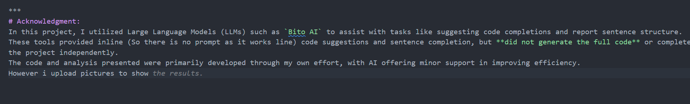

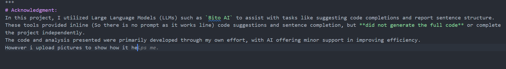

# References:

[Exploiting Expertise of Non-Expert and Diverse Agents in Social Bandit Learning: A Free Energy Approach](https://scholar.google.com/citations?view_op=view_citation&hl=en&user=QlwWxmoAAAAJ&sortby=pubdate&citation_for_view=QlwWxmoAAAAJ:LPtt_HFRSbwC)

Neuroeconomics(Chapter: Prospect Theory)

Hands-on 1 (Previous Project)

[Cumulative Prospect Theory Meets Reinforcement Learning: Prediction and Control](https://arxiv.org/abs/1506.02632)

And several papers which i was reading for my own project these months.
Also I used my previous implementations for algorithms such as Tompson Sampling and Epsilon Greedy.
